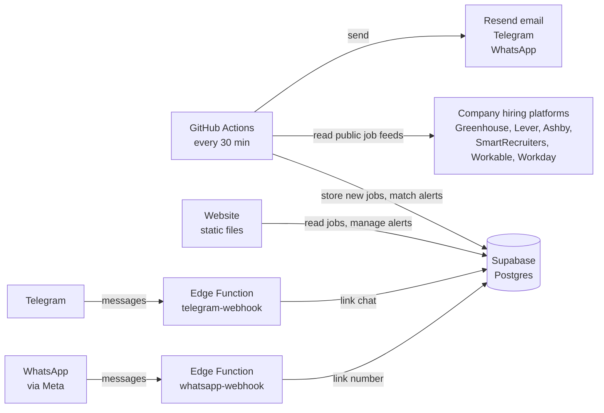

<p align="center">
  <a>
    
  </a>
</p>
<p align="center">
 get a message the moment a company in India posts a job that matches your keywords 🔔
</p>


<p align="center">
  <a href="#run-it"></a>
  <a href="#architecture"></a>
  <a href="#architecture"></a>
  <a href="#services"></a>
  <a href="#put-it-online"></a>
</p>


> **⚠️ Honest framing.** Easy Apply is a small, self-hosted alert service, not a job board and not an auto-apply bot. It reads the public job feeds of companies that use a supported hiring platform (roughly half of the 193 listed companies at first; the rest show as "career page only"), and it never applies for you or scrapes LinkedIn or Naukri. Jobs are checked every 30 minutes, so an alert can arrive up to about an hour after a role is posted (GitHub sometimes delays scheduled runs). The parts were tested against a local PostgreSQL and PostgREST with stand-ins for the outside services (see [Testing](#testing)). It has **not** been run against a live Supabase project, the real Resend, Telegram or Meta services, or the real company job feeds, and the career links in the company list came from memory.


## Table of contents

1. [Run it](#run-it)
2. [Put it online](#put-it-online)
3. [Using Easy Apply](#using-easy-apply)
4. [Configuration](#configuration)
5. [Services](#services)
6. [Limits and costs](#limits-and-costs)
7. [Architecture](#architecture)
8. [Design decisions](#design-decisions)
9. [Project layout](#project-layout)
10. [Testing](#testing)
11. [Local development](#local-development)
12. [Extending](#extending)
13. [Troubleshooting](#troubleshooting)
14. [Known limitations](#known-limitations)
15. [Credits](#credits)


## Run it

You need **Node.js 20.12 or newer** and a free [Supabase](https://supabase.com) project. There is no server of your own to run: the website is static files, the database is Supabase, and a scheduled job does the fetching.

**1. Create the database, one file.** In Supabase open **SQL Editor, New query**, paste all of `supabase/setup.sql`, and press **Run**. It creates every table, index, access rule and function, and loads the 193 companies. It is safe to run again.

**2. Start the project.**

```bash
npm install
cp .env.example .env.local     # fill in the Supabase values (see Configuration)
npm run detect                 # finds which hiring platform each company uses
npm run fetch                  # fetches jobs; the first run is a baseline, no alerts
npm run dev                    # website on http://localhost:5173
```

Open **http://localhost:5173**. Without Supabase values the site shows a setup guide instead of crashing.

| Setup | Result |
| --- | --- |
| Only the database and `npm run dev` | Browse jobs and companies, sign in, save alerts |
| Plus `npm run fetch` on a schedule | Jobs stay fresh and alerts are matched |
| Plus Resend | Alerts arrive by email |
| Plus a Telegram bot | Alerts arrive on Telegram, one tap to connect |
| Plus a Meta WhatsApp app | Alerts arrive on WhatsApp, one tap to connect |

Email, Telegram and WhatsApp are each optional. A channel you have not set up is simply skipped.


## Put it online

Three things go online: the database (already done in step 1), the website, and the scheduled fetcher. **Order matters: database first**, because the website needs its address and the fetcher needs its key.

### 1. Supabase (database and chat webhooks)

Run `supabase/setup.sql` as described above, then open **Authentication, URL configuration**:

| Setting | Value |
| --- | --- |
| Site URL | your website address once you have it, e.g. `https://easyapply.vercel.app` |
| Redirect URLs | `http://localhost:5173/**` and `https://your-site.example/**` |

Optional: turn on the Google provider under **Authentication, Providers**. Email sign-in works without it.

If you want Telegram or WhatsApp, deploy their webhooks as Supabase Edge Functions with the [Supabase CLI](https://supabase.com/docs/guides/cli):

```bash
supabase login
supabase link --project-ref YOUR-PROJECT-REF
supabase secrets set TELEGRAM_BOT_TOKEN=... TELEGRAM_WEBHOOK_SECRET=...
supabase functions deploy telegram-webhook --no-verify-jwt
npm run telegram:webhook          # points the bot at that function, once

supabase secrets set WHATSAPP_TOKEN=... WHATSAPP_PHONE_NUMBER_ID=... WHATSAPP_VERIFY_TOKEN=... WHATSAPP_APP_SECRET=...
supabase functions deploy whatsapp-webhook --no-verify-jwt
```

### 2. Website (any static host)

Vercel, Netlify, Cloudflare Pages, GitHub Pages: anything that serves files.

| Setting | Value |
| --- | --- |
| Root directory | `.` (the project root) |
| Build command | `npm run build` |
| Output directory | `dist` |
| Env vars | `VITE_SUPABASE_URL`, `VITE_SUPABASE_ANON_KEY`, `VITE_TELEGRAM_BOT_USERNAME`, `VITE_WHATSAPP_NUMBER` |

`vercel.json` and `public/_redirects` make links like `/jobs` work when the page is refreshed. These variables are read **when the site is built**, so redeploy after changing them.

### 3. Fetcher (GitHub Actions)

Push the project to a GitHub repository. Under **Settings, Secrets and variables, Actions** add the secrets below. Skip the ones for channels you do not use.

| Secret | Used for |
| --- | --- |
| `SUPABASE_URL`, `SUPABASE_SERVICE_ROLE_KEY` | Reading and writing jobs and alerts |
| `SITE_URL` | Links inside messages, your live website address |
| `RESEND_API_KEY`, `EMAIL_FROM` | Email |
| `TELEGRAM_BOT_TOKEN` | Telegram |
| `WHATSAPP_TOKEN`, `WHATSAPP_PHONE_NUMBER_ID`, `WHATSAPP_TEMPLATE_NAME`, `WHATSAPP_TEMPLATE_LANG` | WhatsApp |

`.github/workflows/fetch-jobs.yml` runs every 30 minutes. Open the **Actions** tab and run it once by hand to confirm it works. `detect-ats.yml` is a manual run that fills in each new company's hiring platform.

### Good to know

- **Use `https://` for the website** and for the Edge Function addresses. Telegram and Meta only call secure addresses.
- **Free plans pause.** GitHub stops scheduled workflows in a repository with no activity for 60 days, and Supabase pauses free projects after a week without traffic. Both can be resumed from their dashboards.
- **A change to the website** needs only a redeploy of the site. A change to `lib/` or `scripts/` is picked up by the next scheduled run.
- **A change to the database** is a new SQL snippet in the SQL Editor. `setup.sql` is idempotent, so re-running it is also fine.


## Using Easy Apply

| Step | Who | What happens |
| --- | --- | --- |
| 1 | You | Open the site and click **Sign in**. Enter your email, or use Google if enabled |
| 2 | You | Open the link we email you. No password |
| 3 | You | Go to **Alerts** and fill in **New alert**: keywords, optional skip words, cities, company groups |
| 4 | You | Tick how you want to hear: **Email**, **Telegram**, **WhatsApp** |
| 5 | You | For Telegram or WhatsApp, tap **Connect** once and send the message that opens |
| 6 | Easy Apply | Every 30 minutes it checks company job boards for roles that appeared since the last check |
| 7 | You | A new match arrives with the role, company, city and an **Apply** button that opens the company's own page |

**Things to try**

- Open **Jobs** and type `react developer` to see everything open now, newest first
- Add a city and tick **Remote only** to narrow the list
- Open **Companies** to see which companies are tracked and which are "career page only"
- Create two alerts with different keywords and use **Pause** on one
- Send `STOP` to the WhatsApp number or `/stop` to the Telegram bot to disconnect

**Alert options**

| Option | Rules |
| --- | --- |
| Keywords | 1 to 20, separated by commas or new lines, up to 60 characters each. Duplicates ignored, any capitalisation |
| Skip roles with | Optional. A role containing any of these words is never sent |
| Cities | Optional, up to 10. Matches part of the job's location, e.g. `Pune`. Empty means all of India |
| Company groups | Optional. Global, IT Services, Indian Enterprise, Unicorn, Mid-size Startup, Startup / Scale-up, Data & AI |
| Remote only | Only roles marked remote |
| Send alerts by | Email, Telegram, WhatsApp, any mix |
| Name | Optional label shown in messages |

You can have up to **20 alerts**. Each alert is its own set of rules and is sent separately.

**How a role is matched.** One keyword matches when **all of its words** appear as whole words in the job title or department, in any order, and plurals count (`developer` matches `developers`, but `react` does not match `reactive`). A role matches an alert when at least one keyword matches, no skip word matches, and the city, remote and company-group filters pass.


## Configuration

Settings are environment variables. Copy `.env.example` to `.env.local` for local use. Names starting with `VITE_` are put into the website and are public. Everything else stays on your machine or in GitHub secrets.

**Website** (read when the site is built)

| Variable | Default | Why |
| --- | --- | --- |
| `VITE_SUPABASE_URL` | none | **Required.** Project address, Supabase Project settings, API |
| `VITE_SUPABASE_ANON_KEY` | none | **Required.** The public anon key. Safe in the browser because access rules protect the data |
| `VITE_TELEGRAM_BOT_USERNAME` | empty | Bot username without the @. Shows the **Connect Telegram** button |
| `VITE_WHATSAPP_NUMBER` | empty | Your WhatsApp business number, digits only with country code, e.g. `919876543210`. Shows **Connect WhatsApp** |

**Fetcher and scripts** (`npm run fetch`, `detect`, `seed`, GitHub Actions)

| Variable | Default | Why |
| --- | --- | --- |
| `SUPABASE_URL` | none | **Required.** Same address as `VITE_SUPABASE_URL` |
| `SUPABASE_SERVICE_ROLE_KEY` | none | **Required.** Bypasses all access rules. Never give it a `VITE_` name |
| `SITE_URL` | `http://localhost:3000` | Your live website address, used for links inside messages |
| `RESEND_API_KEY`, `EMAIL_FROM` | empty | Email. The sender must be on a domain you verified in Resend, e.g. `Easy Apply <alerts@yourdomain.com>` |
| `TELEGRAM_BOT_TOKEN` | empty | Bot token from `@BotFather` |
| `TELEGRAM_WEBHOOK_SECRET` | empty | Any long random string; Telegram sends it back with every webhook call |
| `WHATSAPP_TOKEN` | empty | A permanent System User token with `whatsapp_business_messaging` |
| `WHATSAPP_PHONE_NUMBER_ID` | empty | The phone number's ID (not the number itself), from WhatsApp, API setup |
| `WHATSAPP_VERIFY_TOKEN` | empty | Any long random string you also type into Meta's webhook settings |
| `WHATSAPP_APP_SECRET` | empty | From App settings, Basic. Used to check that webhook calls come from Meta |
| `WHATSAPP_TEMPLATE_NAME` | empty | Your approved template, e.g. `job_alert`. Needed to message people outside the 24 hour window |
| `WHATSAPP_TEMPLATE_LANG` | `en` | Language code of that template |
| `FETCH_CONCURRENCY` | `5` | Companies fetched in parallel |
| `INGEST_ALL` | `false` | `true` keeps jobs from every country instead of India only |

**WhatsApp setup in short.** Create a Business app at [developers.facebook.com](https://developers.facebook.com), add the WhatsApp product and a phone number, create a System User token, and create a **Utility** template named `job_alert` with this body:

```
New jobs for {{1}}: {{2}} See them and apply here: {{3}}
```

Then deploy `whatsapp-webhook`, and in Meta, **WhatsApp, Configuration, Webhook**, set the Callback URL to `https://YOUR-PROJECT-REF.supabase.co/functions/v1/whatsapp-webhook`, paste your verify token and subscribe to the `messages` field.

**Telegram setup in short.** Message `@BotFather`, send `/newbot`, copy the token and the username into the variables above, deploy `telegram-webhook`, and run `npm run telegram:webhook` once.


## Services

| Path | Purpose |
| --- | --- |
| `/` | Home: live counts and the newest jobs |
| `/jobs` | Search open jobs by title, city, company group, remote and company |
| `/companies` | All 193 companies by group, with open role counts and career page links |
| `/alerts` | Create, pause and delete alerts; connect Telegram and WhatsApp. Needs sign-in |
| `/login` | Email link or Google sign-in |
| `https://<project>.supabase.co/rest/v1/` | The database API the website calls directly, guarded by access rules |
| `https://<project>.supabase.co/functions/v1/telegram-webhook` | Telegram calls this when someone messages the bot |
| `https://<project>.supabase.co/functions/v1/whatsapp-webhook` | `GET` is Meta's one-time check; `POST` receives WhatsApp messages |

Commands you run yourself:

| Command | What it does |
| --- | --- |
| `npm run dev` | Start the site locally |
| `npm run build` | Type-check and build to `dist/` |
| `npm run preview` | Serve the built site locally |
| `npm run typecheck` | Type-check everything |
| `npm test` | Run the 61 unit checks |
| `npm run seed` | Load `data/companies.csv` into the database (already done by `setup.sql` the first time) |
| `npm run detect` | Find each company's hiring platform and write `data/ats-guesses.json` |
| `npm run fetch` | Fetch jobs, match alerts and send messages |
| `npm run telegram:webhook` | Point the Telegram bot at your Edge Function |


## Limits and costs

- **Coverage:** only companies on Greenhouse, Lever, Ashby, SmartRecruiters, Workable or Workday are tracked. Big employers with custom career sites (TCS, Infosys, Google, Amazon and similar) appear as "career page only" and send no alerts. Run `npm run detect` to see exactly which of the 193 are tracked.
- **Speed:** a new role is found on the next 30 minute run, then matched and sent in the same run.
- **Message size:** one email lists up to 25 roles, Telegram splits long lists across messages, and WhatsApp text shows up to 10 roles. Any remainder is summarised as "N more" with a link to the site.
- **Email:** needs a sender on a domain you verified in Resend, otherwise mail will not go out or will land in spam.
- **WhatsApp:** a business can only start a chat with an approved template. Easy Apply tries a normal message with apply links first, which works when the person messaged your number in the last 24 hours, and sends your template if WhatsApp says that window has closed. The template carries a summary and a link to the site, not one link per job. **Meta charges for template messages**, so check its current pricing for India before inviting many users. A free test number can message only a few numbers you add in Meta's dashboard.
- **Free tiers:** Supabase, GitHub Actions, Vercel and Resend all have free plans. The project is designed to stay inside them for a few thousand users, but that has not been measured.
- **Retries:** if sending fails, the role is retried on later runs for up to 48 hours, then dropped.


## Architecture




**What happens in one fetch run**

1. Read every active company that has a known hiring platform (`ats` and `ats_token` set).
2. Fetch its public job feed, keep roles located in India, and store new ones. The **first** fetch of a company is a baseline: its existing roles are stored but never alert.
3. Mark roles that disappeared from the feed as closed. An empty feed for a company that had jobs is treated as a glitch and closes nothing.
4. Take roles first seen in the last 48 hours that are not baseline, match them against every active alert, drop the ones already sent, and send the rest by each alert's channels.
5. Log each successful send so it is never repeated.

**Database tables** (all created by `supabase/setup.sql`)

| Table | Holds |
| --- | --- |
| `companies` | The 193 companies, their career page, group, hiring platform and token |
| `jobs` | Roles found on job boards, with apply link, first seen time and baseline flag |
| `profiles` | One row per user: email, Telegram chat, WhatsApp number and their one-use link codes |
| `alerts` | Each user's keyword rules and channels |
| `notifications` | Log of sent alerts, one row per alert, role and channel |

`companies_with_counts` is a view with open role counts for the Companies page. `disconnect_telegram()` and `disconnect_whatsapp()` let a signed-in user clear their own link. A trigger caps alerts at 20 per user and another creates a profile when someone signs up.

**Webhook messages**

| Channel | Message | Meaning |
| --- | --- | --- |
| Telegram | `/start <code>` | Link this chat to the account that owns the code |
| Telegram | `/stop` | Unlink this chat |
| WhatsApp | `Connect <code>` | Link this number to the account that owns the code |
| WhatsApp | `STOP` | Unlink this number |
| WhatsApp | `GET ?hub.challenge` | Meta's one-time webhook check |


## Design decisions

- **No server of your own.** The website is static files that talk to Supabase, and the fetcher is a scheduled job. Nothing runs all day on a machine you pay for or maintain.
- **Public job feeds, not scraping.** Most companies publish jobs through a platform with a public feed, so Easy Apply reads those. It is faster, steadier and allowed. LinkedIn and Naukri are deliberately not scraped: their terms forbid it and they block bots.
- **It never applies for you.** The Apply button opens the company's own page. Automatic applications break company terms and can get people blocked.
- **First fetch is a baseline.** Otherwise connecting a company would send every role it already has. Only roles that appear afterwards trigger alerts.
- **Access rules do the protecting.** The anon key in the browser is public by design. Row level security means a user reads and changes only their own alerts, reads only their own profile and cannot write jobs or companies.
- **Chat links are proven, not typed.** To link Telegram or WhatsApp you send a message containing a one-use code from your own account, so nobody can point alerts at a number or chat they do not own. The code is replaced as soon as it is used. Users cannot edit these fields directly; only the two disconnect functions can clear them.
- **Webhooks check who is calling.** The Telegram webhook requires a secret header. The WhatsApp webhook requires Meta's signature and refuses to run without the app secret.
- **WhatsApp falls back to the template.** Plain messages with links work inside Meta's 24 hour window. When it has closed, the approved template is sent instead, so alerts still arrive.
- **Nothing is sent twice, nothing is lost quietly.** Sent alerts are logged per alert, role and channel. A failed send is not logged, so the next run retries it.
- **A failing company does not stop the rest.** Each company is fetched on its own and its error is stored in `last_error`.
- **India only by default.** Locations are checked against a list of Indian cities and states. `INGEST_ALL=true` turns that off.
- **One file builds the database.** `supabase/setup.sql` is the whole schema plus the company list, and it is safe to run again.
- **A boarding-pass look.** Each job is a ticket with a dashed tear-off stub that holds the Apply button, in navy and saffron.


## Project layout

```
easyapply/
├── src/                       # the website (Vite + React)
│   ├── main.tsx
│   ├── App.tsx                # header, routes, footer
│   ├── auth.tsx               # signed-in user, shared across pages
│   ├── supabase.ts            # browser Supabase client
│   ├── hooks.ts               # loading helper and page titles
│   ├── index.css              # all styling
│   ├── components/            # JobCard, SetupNotice, Status
│   └── pages/                 # Home, Jobs, Companies, Alerts, Login
├── lib/                       # shared by the fetcher, scripts and tests
│   ├── ats/                   # one adapter per hiring platform
│   ├── matcher.ts             # keyword matching
│   ├── notify.ts              # email, Telegram and WhatsApp messages
│   ├── india.ts               # India location detection
│   ├── supabase-admin.ts      # full-access client for scripts only
│   └── types.ts, http.ts, format.ts, segments.ts
├── scripts/                   # seed, detect-ats, fetch-jobs, set-telegram-webhook
├── supabase/
│   ├── setup.sql              # THE database file: tables, rules, functions, companies
│   ├── config.toml            # webhook functions skip the Supabase login check
│   └── functions/             # telegram-webhook and whatsapp-webhook (Deno)
├── data/companies.csv         # the 193 companies
├── tests/logic.ts             # npm test
├── .github/workflows/         # fetch-jobs (every 30 min) and detect-ats (manual)
├── public/                    # favicon and the host redirect file
├── .env.example
├── vercel.json
├── index.html, vite.config.ts, tsconfig.json
├── package.json, package-lock.json
└── README.md
```

| Path | Role |
| --- | --- |
| `src/` | The whole interface. It reads and writes Supabase directly with the signed-in user's rights |
| `lib/ats/` | Turns each platform's job feed into one common job shape |
| `lib/matcher.ts` | Decides whether a job matches an alert |
| `scripts/fetch-jobs.ts` | The fetch, store, match, send and log run |
| `supabase/setup.sql` | The only database file |
| `supabase/functions/` | The two chat webhooks, run by Supabase |

The website and the fetcher share no code at runtime. They meet only through the database, so each can be changed and redeployed on its own.


## Testing

`npm test` runs 61 unit checks and `npm run build` type-checks the whole project. Beyond that, while building, the pieces were run for real against a local **PostgreSQL 16 with PostgREST** (the same API layer Supabase uses). Only the outside world (company job boards, Resend, Telegram, Meta) was replaced with stand-ins that record what would have been sent.

| Area | Checks | What they cover |
| --- | --- | --- |
| Unit (`npm test`) | 61 | Matching, India detection, platform link detection, CSV loader, every adapter's parsing, message building, WhatsApp text then template fallback |
| `setup.sql` | run twice | Runs on an empty database and again on top of itself; 5 tables and a view; 193 companies; earlier sign-ups get a profile |
| Database access rules | 27 | Visitors, user A and user B: who can read and change what, the 20 alert limit, invalid values rejected, disconnect functions touch only your own row |
| Fetch and alert run | 26 | Baseline, matching, apply links, no duplicates, closed jobs, WhatsApp template fallback, retry after an email outage, empty feed protection |
| Telegram and WhatsApp webhooks | 29 | Run as real Deno functions: secret and signature checks, linking and unlinking, one number per account, replayed codes refused |
| Website in a real browser | 26 | Search, filters, paging, companies, create, pause and delete alerts, connect and disconnect, the 21st alert refused, desktop and phone width |

The unit checks ship in this project. The database, fetch run, webhook and browser suites were one-off checks run during the build against a local test stack and are **not** included.

Testing found and fixed one real bug: a counter that lost updates when companies were fetched in parallel.

**Not tested:** a live Supabase project (sign-in emails, Google sign-in, the dashboard), real sends through Resend, Telegram and Meta, Meta's template approval, and the real company job feeds. The adapters follow each platform's public format as I know it, and the tests feed them sample responses of that shape.

A quick manual check after any change:

1. Run `setup.sql`, then `npm run detect` and `npm run fetch`. Each company prints one line; look for `fail` lines.
2. Open `http://localhost:5173/jobs`. Roles should appear, and a keyword search should narrow them.
3. Sign in, create an alert whose keywords match a role that is open now, and tick Email.
4. Run `npm run fetch` again. Nothing should be sent yet, because open roles are the baseline.
5. After a real new role appears on a tracked company (or after you add a test row to `jobs` with `is_baseline` false), run `npm run fetch`. One message should arrive, and a second run should send nothing.
6. Connect Telegram and WhatsApp from the Alerts page and confirm the confirmation message arrives, then test `STOP`.


## Local development

```bash
npm install
npm run dev                  # website with hot reload on :5173
npm run typecheck            # no build needed
npm test                     # unit checks
npm run fetch                # one fetch run against your Supabase project
```

- Edit anything in `src/` and the page reloads on its own.
- Scripts load `.env.local` automatically. In GitHub Actions the values come from repository secrets.
- `npm run fetch` sends real messages to real users. Use a separate Supabase project while developing.
- To see a message without sending it, set only the channel you want to try, and use your own test alert.
- `data/ats-guesses.json` is written by `npm run detect`. It lists boards that exist under a similar name but could not be confirmed (`guesses`) and companies with custom career sites (`unmatched`). Check a few guesses, then copy good ones into the `companies` table (`ats`, `ats_token`) or run `npm run detect -- --accept-guesses`.


## Extending

- **Add a company** — add a row to `data/companies.csv` (`name,slug,careers_url,segment`), then run `npm run seed && npm run detect`.
- **A company the detector could not match** — if its careers page is hosted on a supported platform, set `ats` and `ats_token` on its row in the `companies` table. The token is the part of the careers address after the platform's domain, e.g. `razorpay` in `boards.greenhouse.io/razorpay`. Workday tokens look like `tenant|wd5|SiteName`.
- **Add a hiring platform** — add `lib/ats/<name>.ts` exporting an adapter with `fetchJobs(token)` (copy `lever.ts`, the shortest), register it in `lib/ats/index.ts` with its address pattern in `detectFromText`, add the name to `AtsType` in `lib/types.ts`, and to the `ats` check in `supabase/setup.sql`.
- **Change matching rules** — edit `lib/matcher.ts` and the checks in `tests/logic.ts`.
- **Change message wording** — `lib/notify.ts` holds the email, Telegram and WhatsApp text.
- **Change how often it runs** — the `cron` line in `.github/workflows/fetch-jobs.yml`. Every 30 minutes is `*/30 * * * *`.
- **Add a channel** — add it to the alert channel check and the notification channel check in `supabase/setup.sql`, send it from `scripts/fetch-jobs.ts` with a sender in `lib/notify.ts`, and add a checkbox on `src/pages/Alerts.tsx`.
- **Keep every country** — set `INGEST_ALL=true`, or edit the city list in `lib/india.ts`.
- **Rebrand** — colours are CSS variables at the top of `src/index.css` (`--ink`, `--saffron`, `--teal`, `--mist`); the name is in `index.html` and `src/App.tsx`.
- **Change the limit of 20 alerts** — the `limit_alerts` function in `supabase/setup.sql` and the `check (cardinality(keywords) ...)` on `alerts`.


## Troubleshooting

| Problem | Fix |
| --- | --- |
| The site shows "Connect your database to start" | `VITE_SUPABASE_URL` or `VITE_SUPABASE_ANON_KEY` is missing. Set them and restart `npm run dev`, or redeploy the site |
| Refreshing `/jobs` gives a 404 | The host needs the single page redirect. `vercel.json` and `public/_redirects` provide it; on other hosts add a rule that sends every path to `index.html` |
| The sign-in link does nothing or says it expired | Add your site address with `/**` to Supabase **Redirect URLs**, and request a fresh link |
| `/alerts` sends you to Sign in | You are signed out. Sign in and you return to Alerts |
| No jobs on the site | Run `npm run detect`, then `npm run fetch`. Companies marked "career page only" have no feed to read |
| A company shows "career page only" | It uses a custom career site. See **Extending** to set its platform by hand |
| `npm run fetch` prints `fail` for a company | The message is also stored in that company's `last_error`. Often the board name is wrong or the platform changed its format |
| Alerts never arrive | Check in order: the fetch workflow is running (Actions tab); the role appeared **after** that company's first fetch; the keywords match whole words in the title; the channel is connected and its secrets are set; the role is less than 48 hours old |
| First run sent nothing | Expected. The first fetch of each company is a baseline |
| Email does not arrive | Verify your sending domain in Resend and set `EMAIL_FROM` to an address on it; check spam |
| No Connect Telegram or Connect WhatsApp button | `VITE_TELEGRAM_BOT_USERNAME` or `VITE_WHATSAPP_NUMBER` was not set when the site was built. Set it and redeploy |
| Telegram or WhatsApp connects but no messages come | Tick that channel on the alert, set the channel's secrets in GitHub, and confirm the Alerts page shows it as connected |
| Meta's webhook check fails | The verify token must match `WHATSAPP_VERIFY_TOKEN` exactly, and the function must be deployed with `--no-verify-jwt` |
| WhatsApp only works for a few people | Free test numbers can message only numbers you add in Meta's dashboard. Complete Meta's business setup for real use |
| WhatsApp alerts stop after a day | You used the temporary token. Create a System User token that does not expire |
| "You can have up to 20 alerts" | Delete one on the Alerts page |
| The workflow stopped running | GitHub paused it after 60 days without repository activity. Re-enable it in the Actions tab |
| Everything is empty after a quiet week | The free Supabase project paused. Resume it in the dashboard |


## Known limitations

- About half the listed companies have no public job feed, so they cannot trigger alerts.
- Alerts are not instant: roles are checked every 30 minutes, and GitHub may start a run late.
- Locations are matched with a built-in list of Indian cities and states, so an unusual place name can be missed. `INGEST_ALL=true` disables the filter.
- Matching looks at the job title and department only, not the full description.
- WhatsApp outside the 24 hour window sends a summary and one link, not one link per role, and Meta charges for it.
- No digest or quiet-hours setting yet; every match is sent as it is found.
- There is no applied tracker and no per-job save button yet.
- Company career links in `companies.csv` came from memory and were not verified; some may have moved.
- The database, fetch, webhook and browser tests are not included in the project, and none of it has been run against live Supabase, Resend, Telegram or Meta.
- Not load-tested.


## Credits

Built on [Vite](https://vite.dev), [React](https://react.dev), [Supabase](https://supabase.com), [PostgREST](https://postgrest.org), [Resend](https://resend.com), the [Telegram Bot API](https://core.telegram.org/bots/api), the [WhatsApp Cloud API](https://developers.facebook.com/docs/whatsapp/cloud-api) and [GitHub Actions](https://github.com/features/actions). Company jobs come from the public job boards of Greenhouse, Lever, Ashby, SmartRecruiters, Workable and Workday.
